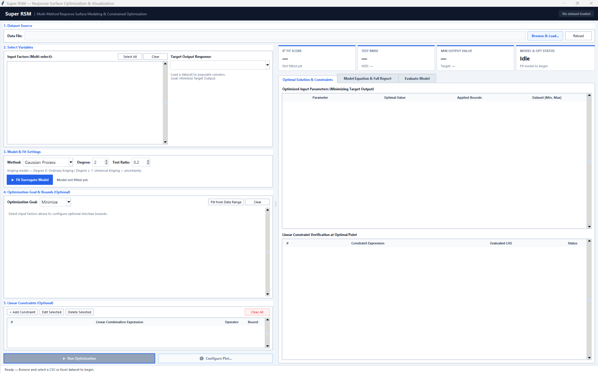

# Super RSM: Multi-Method Response Surface Methodology Analysis & Visualization Suite

**Super RSM** (`super_rsm`) is a modular, extensible Python library and desktop GUI application for fitting multi-dimensional Response Surface Models (RSM), evaluating surrogate predictions with uncertainty bounds, performing continuous constrained optimization, and rendering sliced multi-contour response surfaces.



---

## Key Features

- **Extensible Multi-Method Surrogate Modeling (`super_rsm.models`)**:
  - **Polynomial OLS (Classical RSM)**: Ordinary Least Squares polynomial surfaces with coded variable scaling, Moore-Penrose pseudo-inversion (`pinv`) for collinearity safety, two-tailed term $t$-statistics and $p$-values, Adjusted $R^2$, AIC/BIC, and a full Analysis of Variance (ANOVA) table.
  - **Gaussian Process Regressor (Kriging)**: Ordinary Kriging (`degree_fit=0`) and Universal Kriging (`degree_fit >= 1`) with predictive standard deviation ($\pm 1\sigma$ and 95% CI).
  - **Ridge Regression (`RidgeCV`)**: Cross-validated L2-regularized polynomial regression with analytical unscaling of physical coefficients.
  - **Genetic Programming (`SymbolicRegressor`)**: Evolutionary symbolic regression via `gplearn` that discovers closed-form algebraic equations.
- **Zero-Touch Model Plugin Architecture**:
  - Subclass `BaseRSMModel`, declare `metadata: ClassVar[ModelMetadata]` (including `HyperparameterSpec` schemas), and decorate with `@register_rsm_model`. The desktop GUI automatically adds the model to the dropdown and dynamically generates validated parameter controls without modifying any GUI code.
- **100% Headless Analytical Core (`super_rsm.core`)**:
  - Dataset splitting (`RSMDataset`), pipeline orchestration (`fit_rsm`, `rsm_fromDF`), and Scipy constrained continuous optimization (`OptimizationEngine`) operate completely headlessly with zero import-time dependencies on `tkinter`, `matplotlib`, or `seaborn`.
- **Vectorized Surface Grid & Scoped Visualization (`super_rsm.visualization`)**:
  - Evaluates $100 \times 100$ multi-panel ($P \times Q$) contour grids in single vectorized matrix batches ($<15\text{ ms}$) with experimental scatter overlays and scoped matplotlib styling contexts (`PlotSettings`).
- **Modular MVP Desktop GUI (`super_rsm.gui`)**:
  - Decomposed into cohesive views, dialogs, reusable components, reactive `AppState`, and a thread-safe `AppController` (`_run_async`) so long model fits and optimizations never freeze the UI.

---

## Package Architecture (`super_rsm/`)

Super RSM follows a strict 5-layer inward-dependent Directed Acyclic Graph (DAG), with every module kept concise (<350 lines) for human readability and AI maintainability:

```text
SuperRSM/
├── rsm_gui.py                        # Root GUI launcher entrypoint
├── rsm_backend.py                    # Root headless pipeline & registry facade
├── high_d_plotter.py                 # Root visualization facade
├── sample_data.csv                   # Benchmark quadratic dataset
├── tests/                            # Comprehensive pytest suite (baseline, models, core, visualization, gui)
└── super_rsm/
    ├── common/                       # Layer 0: Types, Enums, Exceptions, HyperparameterSpec, ModelMetadata
    ├── models/                       # Layer 1: BaseRSMModel ABC, ModelRegistry, GP, RidgeCV, Symbolic, PolynomialOLS
    ├── core/                         # Layer 2: Headless RSMDataset, RSMResult, OptimizationEngine, pipeline
    ├── visualization/                # Layer 3: PlotSettings, vectorized GridSampler, MultiContourEngine, VisualizationService
    └── gui/                          # Layer 4: MVP Desktop UI (RSMApp, AppController, AppState, views/, dialogs/, components/, styles/)
```

---

## Installation & Quick Start

### 1. Install Dependencies
```bash
pip install -r requirements.txt
```

### 2. Launch the Desktop GUI
```bash
python -m super_rsm
# or:
python rsm_gui.py
```

### 3. Run the Automated Test Suite
```bash
pytest -v
```

---

## Headless Python API Usage

```python
import pandas as pd
from super_rsm import rsm_fromDF, ConstraintSpec, ConstraintOperator

df = pd.read_csv("sample_data.csv")

# Fit Classical Polynomial OLS (with ANOVA & p-values)
result = rsm_fromDF(
    df=df,
    input_columns=["x1", "x2"],
    output_column="y",
    method="Polynomial OLS",
    degree_fit=2,
)
print(result.summary())

# Constrained continuous optimization (e.g., x1 + x2 <= 6.0)
constraint = ConstraintSpec(coeffs={"x1": 1.0, "x2": 1.0}, operator=ConstraintOperator.LE, bound=6.0)
opt = result.optimize(bounds={"x1": (0.0, 10.0), "x2": (0.0, 10.0)}, constraints=[constraint], maximize=False)
print(f"Optimal parameters: {opt.to_dict(['x1', 'x2'])}, Minimum y = {opt.fun:.4f}")
```

---

## Surrogate Models & Hyperparameter Tuning Guide

Super RSM provides four complementary surrogate modeling families, each suited to different data regimes, noise characteristics, and interpretability requirements. Each model's hyperparameters are validated in headless Python scripts and rendered as dynamic controls in the desktop GUI.

### 1. Polynomial OLS (`method="Polynomial OLS"`)
*Classical Response Surface Methodology via Ordinary Least Squares with Moore-Penrose pseudoinverse, term $p$-values, Adjusted $R^2$, and ANOVA.*

| Hyperparameter | Type | Default | Recommended Range | Description & Advice |
| :--- | :--- | :--- | :--- | :--- |
| `degree_fit` | `int` | `2` | `1` to `3` | **Polynomial Degree**: `1` = planar first-order surface ($y = \beta_0 + \sum \beta_i x_i$). `2` = standard quadratic RSM with two-way interaction ($\beta_{ij} x_i x_j$) and pure quadratic ($\beta_{ii} x_i^2$) curvature terms. `3` = cubic surface.<br/>*Advice:* Use **degree 2** for standard experimental designs (Central Composite, Box-Behnken). Avoid degree $\ge 3$ on small datasets ($N < 30$), as term count grows combinatorially ($p = \binom{d+k}{k}$), risking rank deficiency or severe overfitting. |
| `coded_units` | `bool` | `False` | `True` / `False` | **Coded Variable Transformation**: Maps physical input ranges $[x_{\min}, x_{\max}]$ into dimensionless $[-1, +1]$ coded space before regression, then analytically converts coefficients back to natural physical units.<br/>*Advice:* **Enable (`True`)** whenever factor dimensions differ significantly in magnitude (e.g., Temperature in $[300, 1200]\text{ K}$ vs. Flow Rate in $[0.01, 0.05]\text{ m}^3/\text{s}$). Coded units dramatically improve design matrix condition numbers and enable direct comparison of standardized factor effect sizes. |

> [!TIP]
> **When to Choose Polynomial OLS:** Ideal when your primary goal is classical statistical inference—screening significant factors via $t$-test $p$-values ($p < 0.05$) and verifying lack-of-fit or regression significance through the ANOVA table.

---

### 2. Ridge Regression (`method="RidgeCV"`)
*L2-regularized polynomial regression with cross-validated penalty selection and analytical unscaling of physical coefficients.*

| Hyperparameter | Type | Default | Recommended Range | Description & Advice |
| :--- | :--- | :--- | :--- | :--- |
| `degree_fit` | `int` | `2` | `1` to `4` | **Polynomial Expansion Degree**: Same polynomial basis as OLS, but stabilized by L2 (Tikhonov) shrinkage.<br/>*Advice:* If OLS suffers from collinearity or high variance on a 2nd- or 3rd-degree surface, RidgeCV can safely fit degree 2 or 3 by shrinking correlated weights toward zero. |
| `alphas_count` | `int` | `13` | `10` to `30` | **Alpha Grid Size**: Number of log-spaced regularization penalties ($\alpha \in [10^{-6}, 10^{6}]$) evaluated during cross-validation.<br/>*Advice:* The default of 13 spans 12 orders of magnitude efficiently. Increase to 25–30 if you observe high sensitivity to regularization around moderate multicollinearity. |
| `cv` | `int` | `5` | `3` to `10` | **Cross-Validation Folds**: Number of cross-validation partitions for penalty selection.<br/>*Advice:* Use **5 folds** for general datasets ($N \ge 30$). If working with very small experimental designs ($N < 20$), reduce `cv=3` to guarantee sufficient validation samples per split. |

> [!TIP]
> **When to Choose RidgeCV:** Ideal when your input factors exhibit moderate-to-severe multicollinearity or when fitting higher-order polynomial surfaces where standard OLS yields inflated coefficient variance.

---

### 3. Gaussian Process Regressor (`method="Gaussian Process"`)
*Non-parametric Kriging interpolator with Radial Basis Function (RBF) and WhiteKernel noise, delivering predictive standard deviation ($\pm 1\sigma$ and 95% confidence intervals).*

| Hyperparameter | Type | Default | Recommended Range | Description & Advice |
| :--- | :--- | :--- | :--- | :--- |
| `degree_fit` | `int` | `2` | `0` to `3` | **Trend Basis Degree (Kriging Mode)**:<br/>• `degree_fit = 0`: **Ordinary Kriging** (assumes an unknown constant mean $\mu$).<br/>• `degree_fit >= 1`: **Universal Kriging** (explicit polynomial drift trend + stationary Gaussian covariance).<br/>*Advice:* Use **Ordinary Kriging (`0`)** for complex, multi-modal, or highly non-polynomial responses where a global polynomial trend may bias local interpolation. Use **Universal Kriging (`2`)** when the underlying physics exhibits a dominant quadratic global trend (e.g., unimodal optimization landscapes). |
| `length_scale` | `float` | `1.0` | `0.1` to `10.0` | **RBF Kernel Correlation Length**: Dictates how rapidly spatial correlation diminishes with Euclidean distance in normalized factor space.<br/>*Advice:* Smaller values ($\ell < 1.0$) allow the surrogate to fit localized, sharp features or rapid transitions. Larger values ($\ell > 2.0$) enforce smoother, slower-varying global response surfaces. |
| `noise_level` | `float` | `0.1` | $10^{-5}$ to `1.0` | **Observation Noise Variance ($\sigma_n^2$)**: Variance parameter of the additive WhiteKernel.<br/>*Advice:* For **deterministic computer experiments** (e.g., CFD, FEA, or noise-free simulation code), set `noise_level` very low ($10^{-4}$ or $10^{-5}$) so the GP strictly interpolates measured points. For **noisy laboratory experiments**, set `noise_level = 0.05 - 0.2` to smooth over random measurement error and prevent overfitting. |
| `n_restarts_optimizer` | `int` | `0` | `0` to `5` | **L-BFGS-B Optimizer Restarts**: Number of randomized restarts when maximizing marginal likelihood for kernel hyperparameters.<br/>*Advice:* Keep at `0` for instant interactive exploratory fits in the GUI. Increase to `3` to `5` for final publication-grade optimization models to prevent entrapment in local likelihood sub-optima. |
| `random_state` | `int` | `42` | Any integer | **Random Seed**: Ensures deterministic reproducibility of optimizer restarts and cross-validation splits. |

> [!TIP]
> **When to Choose Gaussian Process:** Mandatory when you require **uncertainty quantification** (e.g., Bayesian optimization, safe design margins, or identifying under-sampled regions of the design space via standard error contours).

---

### 4. Genetic Programming (`method="Genetic Programming"`)
*Symbolic regression using evolutionary algorithms (`gplearn`) to discover closed-form, interpretable mathematical formulas.*

| Hyperparameter | Type | Default | Recommended Range | Description & Advice |
| :--- | :--- | :--- | :--- | :--- |
| `population_size` | `int` | `2000` | `500` to `5000` | **Population Size**: Number of candidate mathematical syntax trees evaluated per generation.<br/>*Advice:* Set to **500–1000** for rapid exploration. Increase to **2000–5000** when searching for compact physical governing equations on complex, non-linear relationships. |
| `generations` | `int` | `20` | `10` to `50` | **Evolutionary Generations**: Number of iterations over which genetic operations (crossover, point mutation, reproduction) evolve the formula population.<br/>*Advice:* **15–25 generations** is typically sufficient for convergence. Exceeding 50 generations significantly increases computation time and risks formula bloat. |
| `parsimony_coefficient` | `float` | `0.005` | `0.001` to `0.05` | **Complexity Penalty Weight**: Penalizes tree length (number of operators and constants) during tournament selection.<br/>*Advice:* If the discovered mathematical formula is excessively long, convoluted, or has giant nested fractions (bloat), **increase to 0.01–0.05**. If the formula underfits or collapses to a trivial constant or linear expression, **decrease to 0.001–0.002**. |
| `random_state` | `int` | `42` | Any integer | **Random Seed**: Ensures evolutionary search runs can be replicated identically. |

> [!TIP]
> **When to Choose Genetic Programming:** Best when you want to discover an explicit, analytical governing equation that can be directly pasted into engineering reports, spreadsheets, or embedded microcontrollers without requiring a machine learning runtime.

---

### General Pipeline Settings

- **Train/Test Validation Split (`test_size`, default: `0.2`)**:
  - The fraction of data held out for calculating test metrics ($R^2$, RMSE, MSE).
  - *Advice:* For standard datasets ($N \ge 30$), `0.2` provides a reliable generalization check. For small experimental designs ($N < 20$), set `test_size = 0.0` or `0.1` to maximize sample data for training.

---

## How to Add a Custom Regression Model (Zero GUI Edits)

To add a new regression model that automatically integrates into both the headless pipeline and the desktop GUI:

1. Create a new module in `super_rsm/models/` (or in your user script) subclassing `BaseRSMModel`.
2. Declare `metadata: ClassVar[ModelMetadata]` with `HyperparameterSpec` items.
3. Decorate the class with `@register_rsm_model`.

```python
from typing import Any, ClassVar, List, Optional
import numpy as np
from sklearn.ensemble import RandomForestRegressor
from sklearn.metrics import mean_squared_error, r2_score

from super_rsm import (
    BaseRSMModel,
    HyperparameterSpec,
    ModelCategory,
    ModelMetadata,
    ModelMetrics,
    register_rsm_model,
)


@register_rsm_model
class RandomForestRSMModel(BaseRSMModel):
    metadata: ClassVar[ModelMetadata] = ModelMetadata(
        name="Random Forest",
        display_name="Random Forest Regressor",
        category=ModelCategory.ENSEMBLE,
        description="Non-parametric tree ensemble regressor with feature importances.",
        supports_uncertainty=False,
        supports_feature_importance=True,
        hyperparameters=[
            HyperparameterSpec("n_estimators", "Trees", int, default=100, min_val=10, max_val=1000, step=10),
            HyperparameterSpec("max_depth", "Max Depth", int, default=6, min_val=1, max_val=30, step=1),
        ],
    )

    def __init__(self, n_estimators: int = 100, max_depth: int = 6, **kwargs: Any):
        super().__init__(n_estimators=n_estimators, max_depth=max_depth, **kwargs)
        self.n_estimators = n_estimators
        self.max_depth = max_depth
        self.estimator: Optional[RandomForestRegressor] = None

    def fit(self, X: np.ndarray, y: np.ndarray, feature_names: Optional[List[str]] = None, **kwargs: Any) -> "RandomForestRSMModel":
        X_arr = np.asarray(X, dtype=float)
        y_arr = np.asarray(y, dtype=float).ravel()
        self.feature_names = list(feature_names) if feature_names else [f"x{i+1}" for i in range(X_arr.shape[1])]

        self.estimator = RandomForestRegressor(
            n_estimators=self.n_estimators,
            max_depth=self.max_depth,
            random_state=42,
        )
        self.estimator.fit(X_arr, y_arr)
        self.X_train, self.y_train = X_arr, y_arr
        self.is_fitted = True

        y_pred = self.estimator.predict(X_arr)
        mse = float(mean_squared_error(y_arr, y_pred))
        self.metrics = ModelMetrics(r2=float(r2_score(y_arr, y_pred)), rmse=float(np.sqrt(mse)), mse=mse)
        return self

    def predict(self, X: np.ndarray) -> np.ndarray:
        self._ensure_fitted()
        X_arr = np.asarray(X, dtype=float)
        if X_arr.ndim == 1:
            X_arr = X_arr.reshape(1, -1)
        return np.asarray(self.estimator.predict(X_arr), dtype=float).ravel()
```
